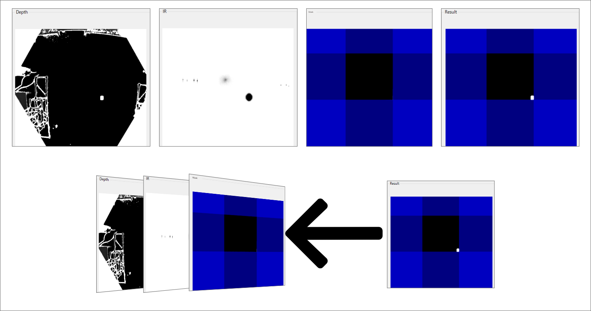
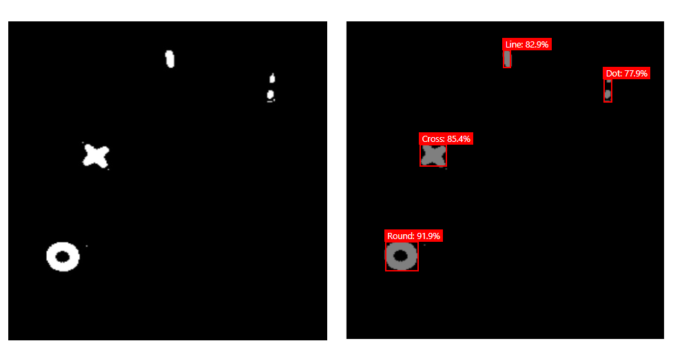
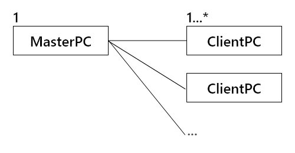
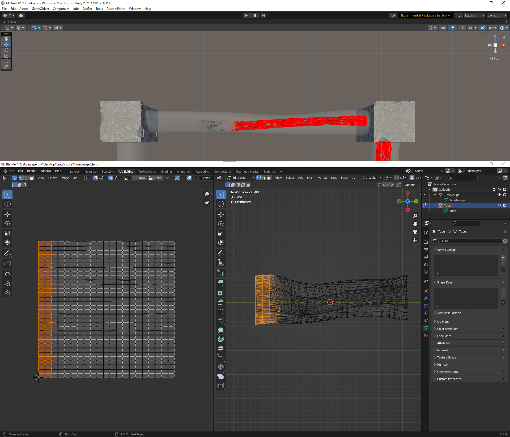
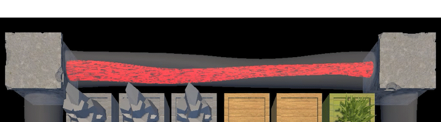
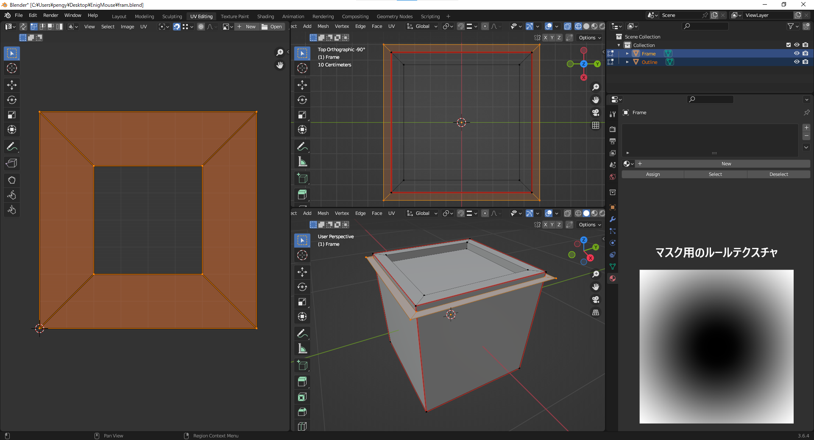
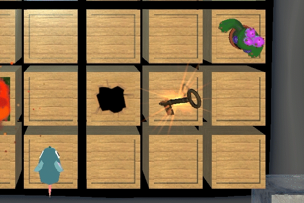

# EnigMouse

---

## 概要

### 使用言語
C#

### 主要ツール
- Unity	2021.3.19f1
- Rider	2022.2.4
- Microsoft Visual Studio Community 2022    17.6.4
- GitHub
- UniRx	7.1.0
- UniTask	2.3.2
- MessagePack-CSharp	2.5.124
- DOTween (HOTween v2)	1.2.745

### 主要開発人数
プランナー : 2人\
プログラマー : 3人\
計5人

### 制作期間
2023/04/21 ~

---

## 担当&実装箇所
ゲーム本編
- 入力周りの処理
- 入力装置との通信
- ゲームの進行
- マスを切り替える処理などを考慮したクラス設計
- 一部のエフェクト
- 残り時間のUI
- いくつかのマネージャークラスの作成\(InputManager ,EffectManager ,GameManager ,TitleManager )

[コードの確認はこちら](https://github.com/to3oi/EnigMouse_Public/tree/main/Assets/Users/Tomoi)

---

入力装置すべて
- ゲーム本編との通信
- Azure Kinect DKを使用した画像処理
- 物体検出のコードの調整
- PC複数台の並列稼働 ( グリッドコンピューティング )

コードの確認はこちら\
\

---

その他
- プロジェクターとAzure Kinect DKと机の距離の調整

---

---

## ストーリー
プレイヤーは魔法学校の生徒。\
授業中誤って2次元に封じ込める魔法を暴走させ、教室の鍵を封印してしまう。\
教室から出るために他の生徒と協力し、鍵を入手して教室から脱出しよう。

---

---

## 操作方法
- このゲームは4人プレイで机を囲んでプレイします。
- プレイヤーはそれぞれ魔導書とそれに対応した魔導具を所持しています。
- 魔導書には自分が発動できる魔法とその効果が記されています。
- 机に現れた特定のマスに魔導具を数秒間かざすことで魔法を発動できます。

---

## こだわり

### 物体検出の精度向上
このゲームの入力は魔導具で行います。\
正確には魔導具に貼られた再帰反射シールの形によって座標と魔法の種類が決まり、魔法が発動できます。\
Azure Kinect DKでは「Depthカメラ (ToF) 、再帰反射シールにより増幅されたIR Emitter ( 近赤外線 )、机より外を簡易的にマスクする処理」の3つをOpenCVのBitwiseAndなどを使用してマスクを掛けることによって以下のResultのような画像が生成できます。

※見やすくするためにマスクする領域を青で示しています。\
実際には青の領域は切り落とされ中央の青のない部分が画像として出力されます。\

ここで出力された画像を物体検出モデルにかけます。\
これにより机の上に必然的に出てくる手や頭などを魔導具と誤検知することが大幅に現象しました。\
以下は実際に使用している物体検出モデルの結果です。\

---

### 物体検出の回数を向上
以前は座標が入力される頻度 ( 物体検出の処理が終了する頻度 ) が10FPS前後で要改善対象でした。\
この相談をしたときにグリッドコンピューティングのことを教えてもらい実装することにしました。\
構成は以下のようにしました。\

MasterPCではAzure Kinect DKの画像処理、ClientPCでは物体検出のみを担当してそのデータのやり取りにUDP通信を使用しました。\
この構成にした理由は処理速度が足りなかったときに、あとからClientPCを追加接続すれば処理速度が上げられるように設計しました。\
これによりMasterPC1台、ClientPC2台で実行して30FPSが安定して出るようになりました。

[技術詳細はここから確認できます。](https://to3oi.hatenablog.com/entry/2023/09/19/151932)

---

### 足りないアセットやエフェクトの作成
趣味でBlenderを使っており、簡単なモデルを作成できます。\
ゲーム内で足りていないオブジェクトを作成しました。

#### 時間制限の表示
ゲーム内で時間を表示するUIの役割をするオブジェクトです。\
作成前から盤面の外周を回ることがわかっていたので、その動きができて尚且つ魔法の世界にあってもおかしくなさそうなものというテーマでうねっている植物をイメージして作成しました。\
内部の赤い部分はUVスクロールで変化するようにシェーダーをシェーダーグラフで作成しました。\
\

---

#### 選択したマスの表示
物体検出の精度により入力したいと実際に入力される座標がずれるということがあり、現在入力している座標を表示するようオブジェクトを作成しました。\
マスの縁にアウトライン用のオブジェクトを追加し、ルールテクスチャで表示領域を切り替えています。\
こちらもシェーダーをシェーダーグラフで作成しました。\
\

---

### GitHubリポジトリ
ゲーム本編\

入力装置\
\

---