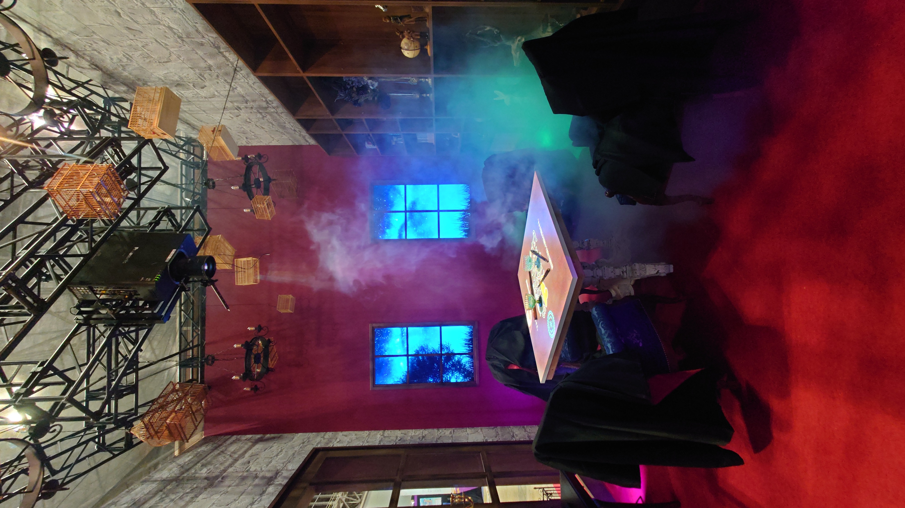
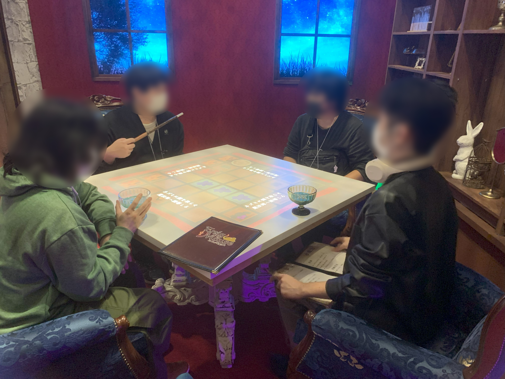
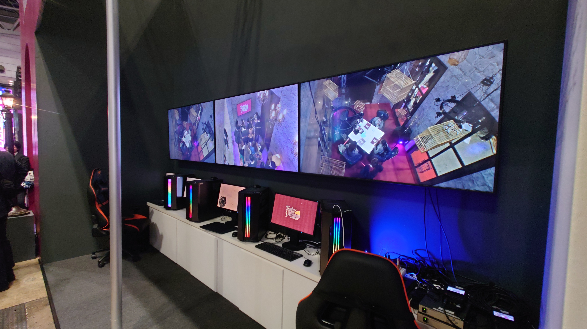

# EnigMouse

---

## 概要

### 使用言語
C#

### 主要ツール
- Unity	2021.3.19f1
- Rider	2022.2.4
- Microsoft Visual Studio Community 2022    17.6.4
- GitHub
- UniRx	7.1.0
- UniTask	2.3.2
- MessagePack-CSharp	2.5.124
- DOTween (HOTween v2)	1.2.745
- Azure Kinect DK

### 主要開発人数
プランナー : 2人\
プログラマー : 3人\
計5人

### 制作期間
2023/04/21 ~

---

## 担当&実装箇所
ゲーム本編
- 入力周りの処理
- 入力装置との通信
- ゲームの進行
- マスを切り替える処理などを考慮したクラス設計
- 一部のエフェクト
- 残り時間のUI
- いくつかのマネージャークラスの作成\(InputManager ,EffectManager ,GameManager ,TitleManager )

[コードの確認はこちら](https://github.com/to3oi/EnigMouse_Public/tree/main/Assets/Users/Tomoi)

---

入力装置すべて
- ゲーム本編との通信
- Azure Kinect DKを使用した画像処理
- 物体検出のコードの調整
- PC複数台の並列稼働 ( グリッドコンピューティング )

コードの確認はこちら\
\

---

その他
- プロジェクターとAzure Kinect DKと机の距離の調整

---

## 展示風景

\
プレイ会場\
\
プレイイメージ\
\
4台のパソコンを通信させ実行している

---
## 動画
PV
<iframe width="560" height="315" src="https://www.youtube.com/embed/uVm_BYSfU6k?si=Sh4VQLLCTEHXl2eO" title="YouTube video player" frameborder="0" allow="accelerometer; autoplay; clipboard-write; encrypted-media; gyroscope; picture-in-picture; web-share" allowfullscreen></iframe>

---

## 実機動画

ショート
<iframe width="560" height="315" src="https://www.youtube.com/embed/PEqBftI_9lw?si=Y4xUUlEHHZ5W-Ndz" title="YouTube video player" frameborder="0" allow="accelerometer; autoplay; clipboard-write; encrypted-media; gyroscope; picture-in-picture; web-share" allowfullscreen></iframe>

---

ロング
<iframe width="560" height="315" src="https://www.youtube.com/embed/Ppuf8xSg_0k?si=Om18CfMI2jsxZ_Wq" title="YouTube video player" frameborder="0" allow="accelerometer; autoplay; clipboard-write; encrypted-media; gyroscope; picture-in-picture; web-share" allowfullscreen></iframe>

---

最新版の変更点
<iframe width="560" height="315" src="https://www.youtube.com/embed/FQPEany49ZA?si=VGayt6KDL2NdaCC_" title="YouTube video player" frameborder="0" allow="accelerometer; autoplay; clipboard-write; encrypted-media; gyroscope; picture-in-picture; web-share" allowfullscreen></iframe>

実行デバイス : Windows & Azure Kinect DK

---

---

EnigMouse Send Master/Client 実行映像
<iframe width="560" height="315" src="https://www.youtube.com/embed/iZKvs_O25Rc?si=Zi0u5GOZ5f5UEW21" title="YouTube video player" frameborder="0" allow="accelerometer; autoplay; clipboard-write; encrypted-media; gyroscope; picture-in-picture; web-share" allowfullscreen></iframe>

実行デバイス : Windows & Azure Kinect DK

---

---

## ストーリー
ある日師匠の書斎に呼ばれた。\
行ってみると師匠である魔女が魔法の実力を試すため課題を用意していた。\
「今日呼んだのはほかでもない。お前たちの魔法の実力を見せて欲しい。」\
どうやら課題をクリアしなくてはこの部屋から出られないようだ。\
制限時間は5分、魔法を使いこなし師匠の課題をクリアせよ。

---

---

## 操作方法
- このゲームは4人プレイで机を囲んでプレイします。
- プレイヤーはそれぞれ魔導書とそれに対応した魔導具を所持しています。
- 魔導書には自分が発動できる魔法とその効果が記されています。
- 机に現れた特定のマスに魔導具を数秒間かざすことで魔法を発動できます。

---

## こだわり

### 物体検出の精度向上
物体検出という技術を使用し、このゲームで使用する魔導具の座標がカメラからどの位置に存在しているかを計算します。\
カメラからのRGB画像のみで魔導具を物体検出で検出することは以下の2点から困難だと考えました。\
- カメラ内に映るプレイヤーの頭や腕を魔導具として検出してしまう可能性がある。
- 物体検出の学習段階の画像と本番の環境の差により正しく使用できる可能性が低い。
そこでどのような環境でも同一の結果が得られるような画像を生成し、物体検出を行うことで上の2点を解決できると考えました。\

Azure Kinect DKにはDepthカメラ（Time of Flightカメラ）とIR Emitter（近赤外線カメラ）と呼ばれる2種類の深度センサーが搭載されています。

検証の結果Azure Kinect DKに100円ショップで購入した反射材を映すことで大まかな反射材の形をIR Emitterで確認することができました。仕組みとしては本来のIR Emitterの測定範囲外で赤外線を反射材で跳ね返すことで反射材の形が取得できます。\
再帰反射シールというより高精度で赤外線を反射できる素材を使用し、OpenCVによる画像マスクを行うことで以下の右下の画像を生成することができました。

※見やすくするためにマスクする領域を青で示しています。\
実際には青の領域は切り落とされ中央の青のない部分が画像として出力されます。\

ここで生成された画像を物体検出モデルにかけることで、上記で懸念していた2点を解消することができ、開発現場と展示会場で同一の座標を取得することができました。
また、副産物として物体検出の精度が上がり、ゲーム内での誤検知が現象しました。

以下は実際に使用している物体検出モデルの結果です。\

---

### 物体検出の回数を向上
物体検出は想像の通り処理負荷が重く実際のゲームと同じ量の入力を取得することはとても困難でした。\
初期段階では1台のPCで物体検出とOpenCVのマスク処理を行い、10FPS前後の入力しか取得できませんでした。\
そこで相談したところグリッドコンピューティングという分散処理について教えてもらい、現状の課題を達成することができそうだったので実装することにしました。\
グリッドコンピューティングを簡単に説明するとネットワーク上にある複数台のPCを使用し、作業を分担する仕組みです。\
この頃1度目の展示を目前に控えており、作業可能な時間は1週間もありませんでした。\
最大効率を引き出すためにタスクの分担をするPC（以降ClientPC）の台数について考慮せず、目的の入力数が得られない場合ClientPCを増設することで対応することにしました。\
具体的には以下の構成です。\

この判断を早々にすることで作業とデバッグの時間が十分に取れ、無事1度目の展示に間に合わせることができました。\
また、当初想定していたClientPCの台数が2台で、30FPSの入力が安定して取得できました。\
30FPSはこのゲームで必要な入力数として設定していた数値だったので、これで入力装置は完成にしました。

[技術詳細はここから確認できます。](https://to3oi.hatenablog.com/entry/2023/09/19/151932)

---

### 足りないアセットやエフェクトの作成
趣味でBlenderを使っており、簡単なモデルを作成できます。\
ゲーム内で足りていないオブジェクトを作成しました。

#### 時間制限の表示
ゲーム内で時間を表示するUIの役割をするオブジェクトです。\
作成前から盤面の外周を回ることがわかっていたので、その動きができて尚且つ魔法の世界にあってもおかしくなさそうなものというテーマでうねっている植物をイメージして作成しました。\
内部の赤い部分はUVスクロールで変化するようにシェーダーをシェーダーグラフで作成しました。\
\

---

#### 選択したマスの表示
物体検出の精度により入力したいと実際に入力される座標がずれるということがあり、現在入力している座標を表示するようオブジェクトを作成しました。\
マスの縁にアウトライン用のオブジェクトを追加し、ルールテクスチャで表示領域を切り替えています。\
こちらもシェーダーをシェーダーグラフで作成しました。\
\

---

#### ステージ変更用のEditor拡張
プランナーでも直感的にすぐステージを試せるようにステージ変更用のエディターウィンドウを追加しました。\
マップを複数追加する、削除する、何もないマスで初期化するなどといった動作ができます。\
以下のGIFではネズミの出現するマスを変更しています。

---

#### ステージ選択の演出

ステージ選択画面を実装する際にプログラマー側から演出の提案をさせていただきました。\
選択したステージ以外のアイコンが燃える演出をシェーダーグラフを使用して制作しました。

---

### GitHubリポジトリ
ゲーム本編\

入力装置\
\

---