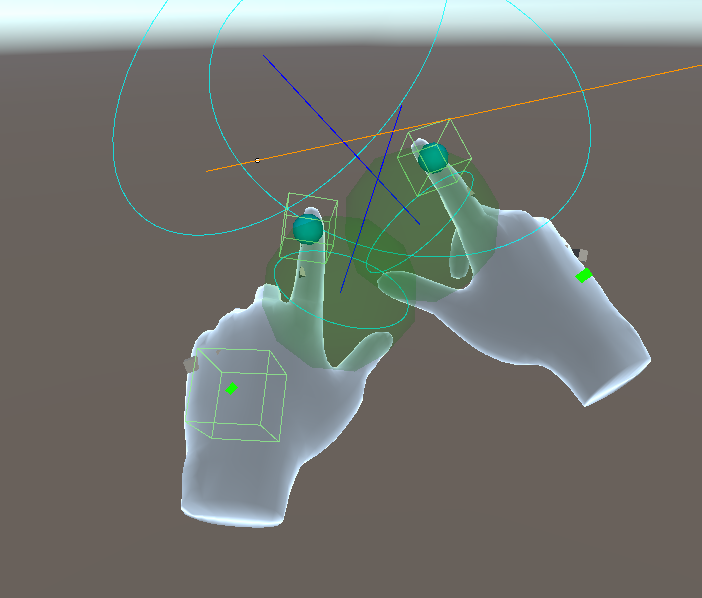

# HoloDive

[GitHubリポジトリ](https://github.com/to3oi/HoloDive-Hololens-Repository-Public)
## ストーリー
過去と未来に干渉する研究をしているあゆむ研究所。
プレイヤーはこの研究所の研究員。
時空干渉デバイスHoloDiveをかぶりあゆむ研究所の爆発を止めよう！

## 操作方法
- プレイヤーは左手の手の甲を右手の人差し指で2回タップすることで時間を移動できます。
- 現在の時間が過去か未来かを確認するには左手の手の甲のマークの色で確認できます。
青で過去、赤で未来の時間にいます。
- チュートリアルのモニターを確認して内容をの通りに操作、移動してください。

## 実機動画

## 実装箇所
Hololens 2の実機で見えるコードすべて
- 環境構築
- ゲームの進行管理
- 画像認識した画像の種類の通知
- エフェクトなどの演出

## こだわり

### 時間軸の移動
手の甲を2回タップすることで時間軸を移動する事ができます。
この処理をするためにMRTKで取得できる指と手の甲の位置に動的にコライダーを配置し、タップの検出ができるようにしました。

### 時間軸移動時のエフェクト
以下の動画のように時間軸を移動したときに、手の座標を中心に波紋のようなエフェクトを実装し、時間軸を移動したことをプレイヤーがわかるようにしました。

[https://youtu.be/smT1GH2vxLM?si=CPyHPoa-XQu3DZ7i&t=32](https://youtu.be/smT1GH2vxLM?si=CPyHPoa-XQu3DZ7i&t=32)

これはShaderGraphで実装し、Hololens 2の実機で処理落ちが少なくなるよう軽量化をしました。
